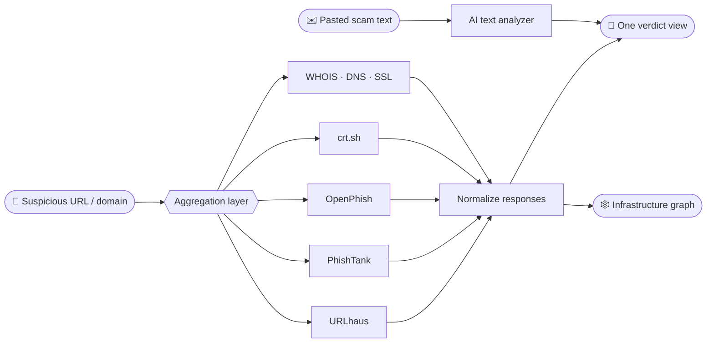

<div align="center">


[](https://saugatrauniyar.com.np)

<a href="https://www.saugatrauniyar.com.np/"></a>
<a href="https://www.linkedin.com/in/saugat-rauniyar/"></a>
<a href="mailto:saugat.rauniyar.work@gmail.com"></a>
<a href="https://instagram.com/rauniyarsaugat"></a>

</div>

---

```console
saugat@raw-swag:~$ whoami
saugat-rauniyar  //  full-stack dev · AI builder · security explorer

saugat@raw-swag:~$ cat education.txt
B.E. Computer Science & Engineering, Siddaganga Institute of Technology, Tumakuru
2025 - 2029  ·  CGPA 9.5 / 10

saugat@raw-swag:~$ cat trophies.log
[2026]  SecLeaf CTF ............ 2nd place · 7,407 pts · team Merp Era
[2026]  HackaFest .............. 3rd place · 50+ teams · Impostr
[2026]  TECHASHY 2.0 ........... IIIT Kottayam · Lucerna · team Aether

saugat@raw-swag:~$ cat philosophy.txt
I don't build tutorial projects. I build things for problems I can see around me.

saugat@raw-swag:~$ _
```

## 🎯 Active Missions

| | Mission | What it is | Status |
|---|---|---|---|
| 🏠 | **[DORMEX](https://github.com/raw-swag/DORMEX)** | Hostel allotment platform for college students: priority-based seat allocation, PostgreSQL integrity constraints, 6-role access control, floor-plan seat picker |  |
| 🩻 | **Lucerna** | Distributed AI diagnostic workstation for radiology with Google MedGemma 4B-IT and clinicians kept in the loop. Built with Team Aether at TECHASHY 2.0, IIIT Kottayam |  |
| 🕵️ | **[Impostr](https://github.com/raw-swag/Impostr)** | Threat-intel and domain forensics platform. 3rd of 50+ teams at HackaFest 2026 |  |
| 🎮 | **ECHOES** | A 2D puzzle-platformer for the browser |  |

### 🔬 Under the hood: how Impostr reaches a verdict



### 🏠 Under the hood: why DORMEX can't double-book a bed

```text
 student clicks "confirm seat"
        │
        ▼
 server checks its OWN clock (client time & priority = untrusted)
        │
        ▼
 PostgreSQL partial unique indexes
   ├─ one CURRENT allocation per seat    / cycle
   ├─ one CURRENT allocation per student / cycle
   └─ one active turn per pool
        │
        ▼
 conflict? the database rejects it, not the UI
```

## 🧰 Arsenal

<p align="center">
  
</p>

<details>
<summary><b>🔍 Full breakdown</b></summary>
<br>

| Domain | Tools |
|---|---|
| **Languages** | C, C++, Java, Python, JavaScript, TypeScript, SQL |
| **Frontend** | React, Next.js, React Native (Expo), Tailwind CSS, HTML5, CSS3 |
| **Backend & data** | Node.js, Express, FastAPI, PHP, PostgreSQL, MySQL, Firebase |
| **AI** | Generative AI, LLM integration, prompt engineering, OpenCV, OCR |
| **Security** | API security, threat-intel APIs, WHOIS/DNS/SSL analysis, CTFs |
| **Desktop & tools** | Electron, pdf-lib, Git, Figma |

</details>

## 🗂️ Side Quests

| Project | Description | Stack |
|---|---|---|
| 🎓 **LoopAngan Certificate Generator** | Desktop app that bulk-generates verifiable course certificates from Excel data | Electron, React, pdf-lib |
| 📋 **TaskBuddy** | Student attendance and productivity tracker | React Native, Firebase, Redux Toolkit |
| 🧪 **CyberDNA** | Hackathon demo: URL scanning, email analysis, QR decoding, in-browser OCR | HTML, React, CDN APIs |
| 🏢 **[Capital Marketing](https://capitalmarketingnp.com)** | Live corporate gifting website for a Nepal-based client | HTML, CSS, JavaScript |
| 🏗️ **[ShubhLabh Construction](https://shubhlabhconstruction.com.np)** | Live company website with service showcase and lead-capture sections | HTML, CSS, JavaScript |

## ✍️ Writing

I write about what I build. Latest: **[From URL to Verdict: Constructing a Multi-Vector Web Threat Forensics Engine](https://medium.com/@saugat.rauniyar.work/from-url-to-verdict-constructing-a-multi-vector-web-threat-forensics-engine-c9eb4722d352?sharedUserId=saugat.rauniyar.work)**, a deep dive into the architecture and design decisions behind Impostr.

## 🏅 Certifications

`API Security · APIsec University (2026)` `Claude Code in Action · Anthropic (2026)` `Prompt Engineering · Infosys Springboard (2026)` `Getting Started with AI on Jetson Nano · NVIDIA (2025)` `Generative AI Literacy · NASSCOM FutureSkills Prime (2025)`

## 🚩 Hidden flag

Since I like CTFs, here's one for you:

```bash
echo 'U2VjTGVhZnt5b3VfcmVhZF90aGVfc291cmNlX25pY2V9' | base64 -d
```

<div align="center">

*"I like building useful things, breaking them, and figuring out how to make them better."*


</div>